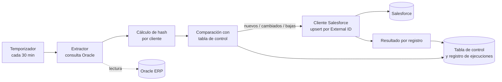

# Integración ERP MONARK → Salesforce: arquitectura de alto nivel

| | |
|---|---|
| **Estado** | Borrador v0.1, pendiente de aprobación |
| **Autor** | Gustavo Fernández Saavedra |
| **Fecha** | 2026-11-03 |
| **Relacionado** | [00-alcance-y-objetivos.md](00-alcance-y-objetivos.md) |

> Este documento describe una **propuesta**. Lo marcado **[Por validar]** depende de datos o decisiones aún pendientes.

## 1. Visión general

Un servicio en segundo plano (worker .NET en Windows) consulta la base de datos Oracle del ERP, detecta qué clientes son nuevos, cambiaron o se dieron de baja, y los envía a la API de Salesforce. Solo lee del ERP: **no modifica sus tablas**.

## 2. Componentes

| Componente | Responsabilidad |
|---|---|
| **Worker (servicio de Windows)** | Ejecuta la sincronización cada 30 minutos y evita ejecuciones solapadas |
| **Extractor Oracle** | Ejecuta las consultas de clientes (jurídicos y naturales) en modo solo lectura |
| **Detector de cambios** | Calcula el hash de cada cliente y lo compara con el guardado |
| **Cliente Salesforce** | Se autentica y envía los registros por upsert |
| **Tabla de control y registro** | Guarda estado, hash, errores e historial de ejecuciones |

## 3. Detección de cambios: hash con tabla de control (propuesta)

Cada ejecución lee los clientes activos, calcula un hash de los campos que se envían y lo compara con el guardado:

- Cliente sin registro en la tabla de control: **nuevo**.
- Hash distinto: **modificado**.
- Cliente en la tabla de control que ya no aparece como activo: **baja**.

**Por qué esta opción:** no exige modificar el ERP (sin columnas nuevas ni triggers) y detecta cambios aunque ocurran en direcciones o datos de persona, tablas distintas de `NMEC`. Con ~219 mil clientes y ~20 cambios al día, leer todo en cada corrida es viable. **[Por validar]** el tiempo real de la consulta en producción y la estabilidad del hash frente a los espacios de los campos `CHAR`.

### Tabla de control (nombres provisionales)

| Campo | Descripción |
|---|---|
| `COD_CLIENTE` | Código del ERP (`NMECCOD`), clave |
| `TIPO` | Persona jurídica o natural |
| `HASH` | Hash de los campos enviados |
| `ESTADO` | Pendiente, OK, Error o Baja |
| `SF_ID` | Identificador del registro en Salesforce |
| `FECHA_ULT_ENVIO` | Último envío correcto |
| `INTENTOS` / `ULTIMO_ERROR` | Seguimiento de fallos para reintentar |

Se complementa con una tabla de ejecuciones (inicio, fin, estado, cantidades leídas, nuevas, modificadas, bajas y errores).

## 4. Integración con Salesforce

Verificado en la documentación oficial de Salesforce:

- **Upsert por External ID:** `PATCH /services/data/<versión>/sobjects/Account/<CampoExterno__c>/<valor>`. Si no existe el valor, crea el registro (HTTP 201); si existe, lo actualiza (HTTP 200). Si el valor coincide con más de un registro, devuelve error 300 y no hace nada. El parámetro `updateOnly=true` evita crear registros nuevos.
- **Autenticación servidor a servidor:** flujo OAuth 2.0 *Client Credentials* con una *External Client App* y un usuario de integración asignado. Se solicita el token con un `POST` al endpoint `/services/oauth2/token` del My Domain de la org. No se emite *refresh token*: el servicio pide un token nuevo al expirar.
- El External ID será el código del cliente del ERP (`NMECCOD`), en un campo personalizado de Account que debe crear el administrador.
- Para las personas naturales el flujo depende de la decisión 4: con Person Account es un único upsert por cliente; con Account + Contact son dos registros vinculados por cliente.

Propuesto, **[por validar]** contra la documentación antes de implementar:

- **Carga inicial:** Bulk API 2.0, en lotes y con punto de reanudación.
- **Sincronización incremental:** upserts agrupados vía REST. Volumen esperado: unas decenas de registros por corrida.

## 5. Carga inicial y sincronización incremental

| | Carga inicial | Sincronización incremental |
|---|---|---|
| **Cuándo** | Una vez, bajo demanda | Cada 30 minutos |
| **Volumen** | ~219 mil a 300 mil clientes **[por validar]** | Decenas de registros |
| **Mecanismo** | Proceso separado, por lotes, reanudable | Worker programado |
| **Idempotencia** | Upsert por External ID | Upsert por External ID |

## 6. Despliegue y operación

- Servidor Windows de MONARK, on premise. El servicio solo necesita **salida HTTPS (443)** hacia Salesforce; no se abren puertos de entrada.
- Se instala como **servicio de Windows**.
- **Sin dependencia de una librería de jobs** en el inicio: un temporizador es suficiente para una sola tarea cada 30 minutos. Se define detrás de una interfaz para poder cambiarlo si crecen las entidades. **[Por validar]** como decisión.
- Se evitan ejecuciones solapadas con un bloqueo en la tabla de control.

## 7. Seguridad y datos personales

- Credenciales de Oracle y de Salesforce **fuera del repositorio**.
- El Consumer Secret de la aplicación de integración debe rotarse periódicamente (advertencia de la documentación de Salesforce).
- El usuario de integración tendrá permisos mínimos.
- Se envían datos personales (teléfono, correo, fecha de nacimiento) a un servicio en la nube. **[Por validar]** con la política de MONARK y la Ley 29733.

## 8. Decisiones pendientes (ADR)

| # | Decisión | Estado |
|---|---|---|
| 1 | Detección de cambios por hash con tabla de control | Propuesta, en revisión |
| 2 | Temporizador propio frente a Quartz.NET u otra librería | Propuesta: temporizador propio |
| 3 | Versión de .NET | .NET 10 definida por el responsable del proyecto; falta confirmar con infraestructura |
| 4 | Person Accounts o Account + Contact | Pendiente, decisión funcional |
| 5 | Mapeo de campos y reglas de limpieza | Pendiente |
| 6 | Estructura de proyectos y convenciones | Pendiente |
| 7 | Representación de las bajas en Salesforce (marcar inactivo o eliminar) | Pendiente, decisión funcional |
